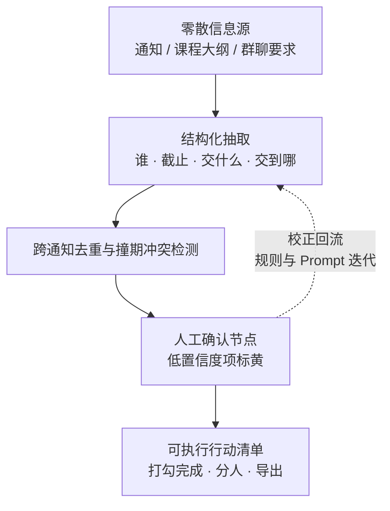

# 通知猎人 NoticeHunter

> 把校园通知、课程大纲、群聊里的碎片要求，转成一份**「谁 / 什么时候前 / 交什么 / 交到哪」**的可执行行动清单。

杭州电子科技大学第二届 AIGC 应用创新大赛参赛作品 ｜ 赛题一「AI 辅助开发 · 创意产品原型」

---

## 为什么做这个

一个学期里，学院通知、竞赛公告、选课时段、体测报名、四六级报名、奖助学金材料、课程大作业要求……全都散落在不同渠道，各自独立地告诉你「什么时候截止」。漏掉一件就是一次事故，而多份通知之间的截止时间冲突，没有任何人会替你汇总。

《通知猎人》解决的正是这最后一步：**从「信息」到「行动」**。

---

## 核心闭环



**验收标准**：拿本项目自己的竞赛通知跑一遍，出来的清单能让团队直接照着分工动手。

---

## 四道必须守住的设计

作品最容易退化成「又一个 AI 文档摘要」。下面四点是它和摘要的区别，也是这四点让它站得住：

1. **只输出动作，不输出摘要** —— 每条待办是「谁 + 截止 + 交什么 + 交到哪」的结构化字段，不是一段总结文字。
2. **每条都能点回原文出处** —— 高亮定位到原段落，解决 AI 幻觉带来的信任问题。
3. **低置信度项强制人工确认** —— 模糊或冲突的条目标黄，必须人工确认后才写入清单，不让 AI 替你拍板。
4. **跨文件去重与撞期预警** —— 同一截止时间自动合并，时间冲突主动报警。

---

## 范围纪律（做之前先看）

| | 内容 |
| --- | --- |
| **MVP（必须）** | 单页网页 · 支持 `.docx` / `.txt` 输入 · 结构化抽取 · 人工确认 · 行动清单打勾 · 导出文本清单 · **断网可用内置样例完整演示** |
| **加分项（有余力才做）** | 多文档合并 · 日历导出 · 多人分工视图 · PDF / 图片 OCR |
| **明确不做** | 账号体系 · 后端服务 · 云数据库 · 移动端 App |

原则来自评审口径：**「强调对 AIGC 技术的理解、选择与组合运用能力，而非复杂的底层代码开发。」** 不为炫技加功能。

---

## 快速开始

```bash
git clone <你的仓库地址>
cd notice-hunter

# 方式一：直接用浏览器打开（无需任何依赖）
#   双击 prototype/index.html

# 方式二：起一个本地静态服务器
python -m http.server 8731 --bind 127.0.0.1
# 打开 http://127.0.0.1:8731/
```

**零构建、零 npm 依赖、零外部网络请求。** 演示环境不保证有网，所以一切离线可跑。

---

## 如何复现验收结果

原型的正确性由**浏览器实测**证明，不靠「应该可以」。两套脚本共 **99 条断言**，预期全部 `PASS / 0 FAIL`：

| 脚本 | 前提 | 覆盖 |
| --- | --- | --- |
| `node prototype/verify.cjs` | 只起静态服务器，**不配 Key** | 规则式路径 **30 条**：`.docx` 解析、损坏文件中文提示、人工确认、撞期、导出、`file://` 直开、零外部网络请求 |
| `node prototype/verify-llm.cjs` | 静态服务器 + 本地 stub | AI 路径 **69 条**：五类故障回退、分批顺序发送、S2.11 五项硬上限、R-17 预算跨刷新保留 |

```bash
# 1) 起静态服务器（在仓库根，不是 prototype/）
python -m http.server 8761 --bind 127.0.0.1

# 2) 起本地 OpenAI 兼容桩（只有 verify-llm 需要；产品不引用它）
node prototype/test/fake-llm-server.js --port=8791

# 3) 指向本机已有的 playwright-core —— 见下方「找不到 playwright-core」
$env:NODE_PATH = "<你的路径>"

# 4) 跑
cd prototype
node verify.cjs
node verify-llm.cjs
```

### 找不到 playwright-core 怎么办

`node_modules/` 被 `.gitignore` 排除，仓库也**没有 `package.json`**——这是刻意的，产品必须保持零依赖。代价是测试驱动器只能靠 `NODE_PATH` 指向**本机已有的拷贝**，而那条路径（npx 缓存目录名带哈希）因机器而异。

缺依赖时脚本**不会**抛一个裸的 `Cannot find module 'playwright-core'` 就完事，而是打印完整复原步骤，见 `prototype/test/load-playwright.cjs`：

- **方式一**：复用已有拷贝，仓库仍不引入依赖 —— `npm root -g`，或 npx 缓存 `D:\nodejs\node_cache\_npx\<hash>\node_modules`，设给 `NODE_PATH`
- **方式二**：装在仓库之外 —— `npm i playwright-core --prefix .nh-test --no-save`，再把 `.nh-test\node_modules` 设给 `NODE_PATH`

浏览器用**本机 Edge**（脚本内 `channel: 'msedge'`），无需另外下载 Chromium。

整套跑完约 **140 秒**，其中约 50 秒是「60 次请求触顶」测试的 800ms 节流代价——那是安全特性的固有成本，不是卡顿。

---

## 仓库结构

```
AGENTS.md              协作与交接契约（规则、边界、验证要求、本机工具链）
HANDOFF.md             进度真相源（当前位置、决策记录、任务板、变更日志）
README.md              本文件
prototype/             可运行原型（纯静态单页）
  ├─ samples/          模拟样例数据与测试夹具（禁止真实隐私数据）
  ├─ test/             测试设施（fake-llm-server、playwright 加载器）
  ├─ verify.cjs        规则式路径验收（30 条）
  └─ verify-llm.cjs    AI 路径验收（69 条）
prompts/               关键 Prompt 留档（评分项，只增不改）
docs/compose/spec/     功能规格（含交付报告与已知未修项）
```

项目文档、方案 PPT、演示视频等交付物目录，待立项确认后按 `HANDOFF.md` 任务板建立。

---

## 工具与 AI 使用说明

本项目的 AI 使用过程**留档在 [`prompts/`](prompts/README.md)**，遵循三条铁律：只增不改、原文原样粘贴、从第一天开始记。

项目文档末尾会附完整的 **AI 工具使用、关键 Prompt、生成或开发过程、迭代优化、测试验证、人工核查情况**——这是竞赛评分首项的要求，也是本仓库里 `prompts/` 与 `HANDOFF.md` 变更日志存在的意义。

> 任何 AI 生成的内容在提交前都经过**人工核查**，核查发现的错误会如实记录在对应条目里，而不是抹掉。

---

## 隐私与数据说明

- 原型内所有样例均为**模拟数据**，放于 `prototype/samples/`，不含任何真实个人身份信息。
- 演示若引用真实通知或群聊截图，必须先**打码**（姓名、学号、联系方式、头像），未打码的原始素材已由 `.gitignore` 排除在仓库之外。
- API Key 一律通过环境变量或界面输入读取，**不写入代码、不进仓库**。
- 没有 Key 时，原型仍可用内置样例完整走通闭环。

---

## 项目状态

见 [`HANDOFF.md`](HANDOFF.md) 第 1 节「当前位置」与第 4 节「任务板」——那是唯一的进度真相源，本文件的描述不会随手更新。

> 作品方向已确认：**赛题一 ·《通知猎人 NoticeHunter》**，见 `HANDOFF.md` 决策记录 D-001 / D-002（2026-10-13 用户确认，对应风险条目 R-02 已解除）。

---

## 协作与交接

本项目采用多智能体协同开发。**任何智能体动手前先读 [`AGENTS.md`](AGENTS.md) 与 [`HANDOFF.md`](HANDOFF.md)**：前者是规则与约束，后者是进度真相源。改文件前在 `HANDOFF.md` 第 4 节登记占用，收工释放并追加变更日志。
