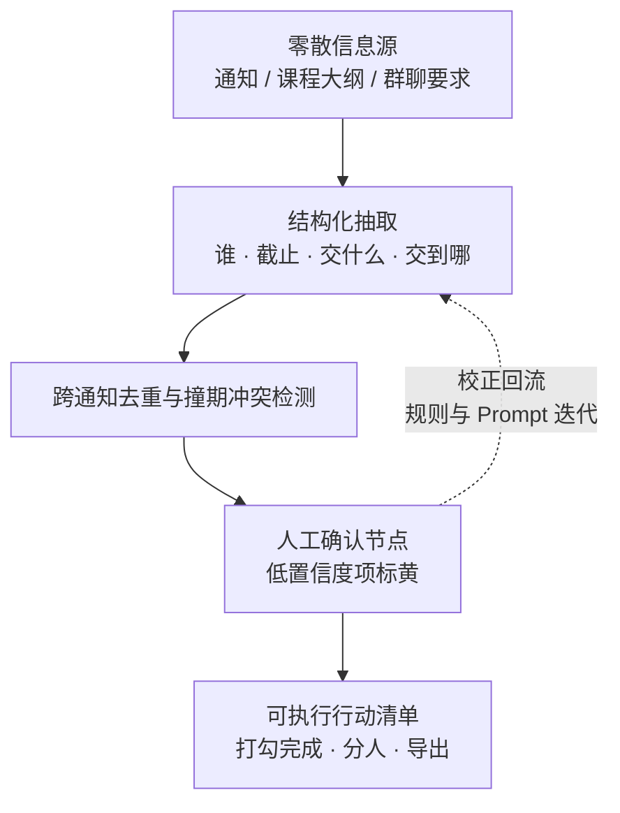

# 通知猎人 NoticeHunter

> 把校园通知、课程大纲、群聊里的碎片要求，转成一份**「谁 / 什么时候前 / 交什么 / 交到哪」**的可执行行动清单。

杭州电子科技大学第二届 AIGC 应用创新大赛参赛作品 ｜ 赛题一「AI 辅助开发 · 创意产品原型」

---

## 为什么做这个

一个学期里，学院通知、竞赛公告、选课时段、体测报名、四六级报名、奖助学金材料、课程大作业要求……全都散落在不同渠道，各自独立地告诉你「什么时候截止」。漏掉一件就是一次事故，而多份通知之间的截止时间冲突，没有任何人会替你汇总。

《通知猎人》解决的正是这最后一步：**从「信息」到「行动」**。

---

## 核心闭环



**验收标准**：拿本项目自己的竞赛通知跑一遍，出来的清单能让团队直接照着分工动手。

---

## 四道必须守住的设计

作品最容易退化成「又一个 AI 文档摘要」。下面四点是它和摘要的区别，也是这四点让它站得住：

1. **只输出动作，不输出摘要** —— 每条待办是「谁 + 截止 + 交什么 + 交到哪」的结构化字段，不是一段总结文字。
2. **每条都能点回原文出处** —— 高亮定位到原段落，解决 AI 幻觉带来的信任问题。
3. **低置信度项强制人工确认** —— 模糊或冲突的条目标黄，必须人工确认后才写入清单，不让 AI 替你拍板。
4. **跨文件去重与撞期预警** —— 同一截止时间自动合并，时间冲突主动报警。

---

## 范围纪律（做之前先看）

| | 内容 |
| --- | --- |
| **MVP（必须）** | 单页网页 · 支持 `.docx` / `.txt` 输入 · 结构化抽取 · 人工确认 · 行动清单打勾 · 导出文本清单 · **断网可用内置样例完整演示** |
| **加分项（有余力才做）** | 多文档合并 · 日历导出 · 多人分工视图 · PDF / 图片 OCR |
| **明确不做** | 账号体系 · 后端服务 · 云数据库 · 移动端 App |

原则来自评审口径：**「强调对 AIGC 技术的理解、选择与组合运用能力，而非复杂的底层代码开发。」** 不为炫技加功能。

---

## 快速开始

```bash
git clone <你的仓库地址>
cd notice-hunter

# 方式一：直接用浏览器打开（无需任何依赖）
#   双击 prototype/index.html

# 方式二：起一个本地静态服务器
python -m http.server 8731 --bind 127.0.0.1
# 打开 http://127.0.0.1:8731/
```

**零构建、零 npm 依赖、零外部网络请求。** 演示环境不保证有网，所以一切离线可跑。

---

## 仓库结构

```
AGENTS.md              协作与交接契约（规则、边界、验证要求、本机工具链）
HANDOFF.md             进度真相源（当前位置、决策记录、任务板、变更日志）
README.md              本文件
prototype/             可运行原型（纯静态单页）
  └─ samples/          模拟样例数据与测试夹具（禁止真实隐私数据）
prompts/               关键 Prompt 留档（评分项，只增不改）
```

项目文档、方案 PPT、演示视频等交付物目录，待立项确认后按 `HANDOFF.md` 任务板建立。

---

## 工具与 AI 使用说明

本项目的 AI 使用过程**留档在 [`prompts/`](prompts/README.md)**，遵循三条铁律：只增不改、原文原样粘贴、从第一天开始记。

项目文档末尾会附完整的 **AI 工具使用、关键 Prompt、生成或开发过程、迭代优化、测试验证、人工核查情况**——这是竞赛评分首项的要求，也是本仓库里 `prompts/` 与 `HANDOFF.md` 变更日志存在的意义。

> 任何 AI 生成的内容在提交前都经过**人工核查**，核查发现的错误会如实记录在对应条目里，而不是抹掉。

---

## 隐私与数据说明

- 原型内所有样例均为**模拟数据**，放于 `prototype/samples/`，不含任何真实个人身份信息。
- 演示若引用真实通知或群聊截图，必须先**打码**（姓名、学号、联系方式、头像），未打码的原始素材已由 `.gitignore` 排除在仓库之外。
- API Key 一律通过环境变量或界面输入读取，**不写入代码、不进仓库**。
- 没有 Key 时，原型仍可用内置样例完整走通闭环。

---

## 项目状态

见 [`HANDOFF.md`](HANDOFF.md) 第 1 节「当前位置」与第 4 节「任务板」——那是唯一的进度真相源，本文件的描述不会随手更新。

> 作品方向（赛题一 / 《通知猎人》）当前状态为**待团队确认**，见 `HANDOFF.md` 决策记录 D-001 / D-002。确认前上述方案描述可能调整。

---

## 协作与交接

本项目采用多智能体协同开发。**任何智能体动手前先读 [`AGENTS.md`](AGENTS.md) 与 [`HANDOFF.md`](HANDOFF.md)**：前者是规则与约束，后者是进度真相源。改文件前在 `HANDOFF.md` 第 4 节登记占用，收工释放并追加变更日志。
