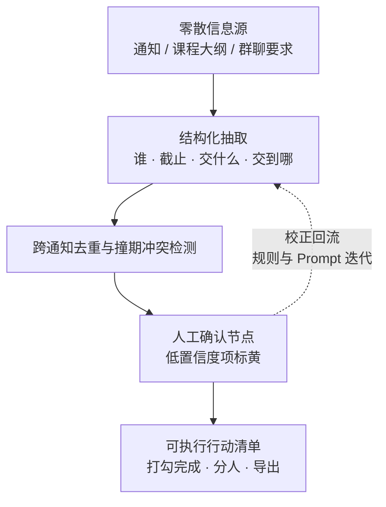

# 通知猎人 NoticeHunter

> 把校园通知、课程大纲、群聊里的碎片要求，转成一份**「谁 / 什么时候前 / 交什么 / 交到哪」**的可执行行动清单。

杭州电子科技大学第二届 AIGC 应用创新大赛参赛作品 ｜ 赛题一「AI 辅助开发 · 创意产品原型」

---

## 为什么做这个

一个学期里，学院通知、竞赛公告、选课时段、体测报名、四六级报名、奖助学金材料、课程大作业要求……全都散落在不同渠道，各自独立地告诉你「什么时候截止」。漏掉一件就是一次事故，而多份通知之间的截止时间冲突，没有任何人会替你汇总。

《通知猎人》解决的正是这最后一步：**从「信息」到「行动」**。

---

## 核心闭环



**验收标准**：拿本项目自己的竞赛通知跑一遍，出来的清单能让团队直接照着分工动手。

---

## AI 抽取背后：一次真实请求长什么样

> 点下「AI 抽取」之后，浏览器**不会把整份文件直接丢给模型**。它先在本地用规则筛出「含时间信息」的段落，再带上前后文，只把这些段落发出去；模型只负责理解语义，返回的每个字段还要过一遍本地校验。

### 一次抽取的 6 步

| 步骤 | 代码 | 做什么 |
| --- | --- | --- |
| 1. 解析 | `parseTxt()` / `readDocxXml()` | `.txt` 按非空行、`.docx` 按 `w:p` 拆成段落数组；全程本地，零依赖 |
| 2. 筛候选 | `selectCandidateParagraphs()` | 用 `detectDue()` 找出含明确日期或模糊时间词的段落；**没有候选就不发请求** |
| 3. 带上下文 | 同上 | 每个候选段前后各带 2 段，另加首段（标题）；按 `[段号] 正文` 拼给模型 |
| 4. 切批 | `chunkParagraphs()` | 单请求 ≤60 段、≤12000 字符；单段超 2000 字时只截断「送模型的副本」 |
| 5. 发请求 | `callLLM()` / `llmRequest()` | `POST {base}/chat/completions`，`temperature: 0`，`max_tokens: 2048` |
| 6. 收结果 | `parseModelContent()` / `mapLLMEntries()` | 容错解析 JSON；校验 `due` / `sourceIndex` / `action`，按原文校正年份与出处，去重 |

### 请求头

```http
POST {base}/chat/completions
Authorization: Bearer <你的 API Key>
Content-Type: application/json
```

Key 只在 `Authorization` 头里：**不进请求体、不进 URL、不写 `localStorage` / `sessionStorage`、不出现在导出文本**。刷新页面即从内存清空。

### 请求体骨架

```json
{
  "model": "demo-model",
  "temperature": 0,
  "max_tokens": 2048,
  "messages": [
    { "role": "system", "content": "……抽取规则 + JSON schema + 示例……" },
    { "role": "user", "content": "文件：notice-internship.txt\n\n[1] ……\n[2] ……" }
  ]
}
```

### 实际发出的内容

下面这份请求是用仓库自带的本地 OpenAI 兼容桩 `prototype/test/fake-llm-server.js` **实际捕获**的，样例为 `prototype/samples/notice-internship.txt`。产品代码**不引用**这个桩；换成真实端点时，同一天、同一文件的 body 只有 `model` 变（URL 在请求行、Key 在请求头），结构不变。完整原始 JSON 已存为 [`docs/ai-request-example.json`](docs/ai-request-example.json)，可直接与 DevTools 的 Payload 对照。

> 这份材料证明的是「客户端到底发出去什么」，不是「真实模型返回得准不准」。后者仍未在真实第三方 API 上验收，见 `HANDOFF.md` 的 R-21。

**system prompt** 包含四块：身份与日期锚点、输出格式、8 条规则、1 条示例。日期是**每次请求现算**的（示例里是捕获当天 2026-11-21，实际运行会变成当天），所以模型知道「今天」：

```text
你是校园通知的结构化抽取器，把一份通知转成可执行的待办清单。
今天是 2026 年 11 月 21 日（周六）。文档里不带年份的日期一律按 2026 年理解。

…… JSON schema（action / owner / where / dueRaw / due / sourceIndex / confidence / reasons）……

规则（逐条遵守）：
1. 一条待办只写一个动作……
2. dueRaw 必须逐字出现在 sourceIndex 指向的那一段里……
3. 截止时间和动作分处不同段落时……action 从相邻段落取真正的动作……
4. 只有时间、没有动作的段落不要单独输出待办……
5. 相对时间（本周内、下周三前……）due 必须为 null，confidence 为 low……
6. 执行者判断：「任课教师」是签字人，不是办事人……
7. confidence 为 high 必须同时满足：明确日历日期、动作明确、依据能在原文找到……
8. 宁可少抽，不可编造……

示例（只示意格式）：……
```

完整 prompt 原文见 [`prompts/P-003-LLM抽取精度优化.md`](prompts/P-003-LLM抽取精度优化.md)；上面只摘了结构与规则要点，逐字原文在 [`docs/ai-request-example.json`](docs/ai-request-example.json) 的 `messages[0].content`。

**user content** 只包含候选段及其上下文。样例文件有 22 段（30 行，空行不计），这次实际只发了 13 段：

```text
文件：notice-internship.txt

[1] 关于做好 2026 届毕业实习材料提交工作的通知
[2] 发布单位：示例大学 材料与能源学院（模拟数据 · 非真实通知）
[3] 发布日期：2026 年 10 月 13 日
[4] 各班级：
[5] 为规范毕业实习管理，现将 2026 届毕业实习材料提交工作通知如下。
[12] 4. 实习过程照片 3 张，电子版，JPG 格式。
[13] 三、提交时间与地点
[14] 请于 2026 年 11 月 5 日（周四）17:00 前，将纸质材料交至学院学生事务办公室（示例楼 A301）。
[15] 电子版材料以「学号+姓名」命名，发送至 example@university.edu.cn（示例邮箱）。
[16] 四、注意事项
[20] 联系人：示例老师（模拟数据） 电话：0000-00000000
[21] 材料与能源学院
[22] 2026 年 10 月 13 日
```

为什么是这 13 段：候选段是 [3]、[14]、[22]（含日期），各带前后 2 段，再加首段 [1]。中间的 [6]–[11]、[17]–[19] 没有时间信息，不送。

> **边界**：窗口是 ±2 段，不是整节。像 [6]–[11] 这种「提交内容 1–3」离截止段较远时不会进请求体——这是「成本 / 上下文」与「召回」的取舍，也是 prompt 里要求「动作可从相邻段取」的原因。

### 模型返回之后，前端不直接信

1. `parseModelContent()` 五级容错：去围栏 → 括号配对 → 单对象包装 → 截断补齐 → 逐对象抢救；
2. `mapLLMEntries()` 逐字段校验：`due` 必须匹配日期格式，否则用 `dueRaw` 经规则重算；`sourceIndex` 越界且原文找不到依据就丢弃；`dueRaw` 在原文里找不到依据 → 强制 `low`；同文件按 `action + due + owner` 去重；
3. 任何一步失败 → 该文件**整体回退规则式**，主流程不中断。

### 硬上限

| 限制 | 值 | 目的 |
| --- | --- | --- |
| 单请求段落 | 60 段 | 控制上下文与单次费用 |
| 单请求字符 | 12000 字符 | 防止超长段落撑爆上下文 |
| 单段送模型 | 2000 字符 | 只截断「副本」，原文与卡片仍保留全文 |
| `max_tokens` | 2048 | 封死输出膨胀 |
| 单次超时 | 30 秒 | 慢模型不至于立刻回退 |
| 请求间隔 | 800 毫秒 | 防止瞬间打出大量请求 |
| 会话请求上限 | 60 次 | 刷新页面也保留计数（只存计数，不存 Key） |

### 自己验证

- **DevTools**：F12 → Network → 过滤 `chat/completions` → 看 Payload，body 就是上面这份结构；
- **仓库 stub**：先起 `node prototype/test/fake-llm-server.js --port=8791`，把设置里的 Base URL 填 `http://127.0.0.1:8791`，跑一次后访问 `http://127.0.0.1:8791/__state`，`lastBody` 就是最后一次请求体；
- **不需要 Key**：不配置 Key 时页面根本不发请求，规则式路径仍能完整演示。

---

## 四道必须守住的设计

作品最容易退化成「又一个 AI 文档摘要」。下面四点是它和摘要的区别，也是这四点让它站得住：

1. **只输出动作，不输出摘要** —— 每条待办是「谁 + 截止 + 交什么 + 交到哪」的结构化字段，不是一段总结文字。
2. **每条都能点回原文出处** —— 高亮定位到原段落，解决 AI 幻觉带来的信任问题。
3. **低置信度项强制人工确认** —— 模糊或冲突的条目标黄，必须人工确认后才写入清单，不让 AI 替你拍板。
4. **跨文件去重与撞期预警** —— 同一截止时间自动合并，时间冲突主动报警。

---

## 范围纪律（做之前先看）

| | 内容 |
| --- | --- |
| **MVP（必须）** | 单页网页 · 支持 `.docx` / `.txt` 输入 · 结构化抽取 · 人工确认 · 行动清单打勾 · 导出文本清单 · **断网可用内置样例完整演示** |
| **加分项（有余力才做）** | 多文档合并 · 日历导出 · 多人分工视图 · PDF / 图片 OCR |
| **明确不做** | 账号体系 · 后端服务 · 云数据库 · 移动端 App |

原则来自评审口径：**「强调对 AIGC 技术的理解、选择与组合运用能力，而非复杂的底层代码开发。」** 不为炫技加功能。

---

## 快速开始

```bash
git clone <你的仓库地址>
cd notice-hunter

# 方式一：直接用浏览器打开（无需任何依赖）
#   双击 prototype/index.html

# 方式二：起一个本地静态服务器
python -m http.server 8731 --bind 127.0.0.1
# 打开 http://127.0.0.1:8731/
```

**零构建、零 npm 依赖、零外部网络请求。** 演示环境不保证有网，所以一切离线可跑。

---

## 如何复现验收结果

原型的正确性由**浏览器实测**证明，不靠「应该可以」。两套脚本共 **151 条断言**，预期全部 `PASS / 0 FAIL`：

| 脚本 | 前提 | 覆盖 |
| --- | --- | --- |
| `node prototype/verify.cjs` | 只起静态服务器，**不配 Key** | 规则式路径 **67 条**：`.docx` 解析、损坏文件中文提示、人工确认、撞期、导出、`file://` 直开、零外部网络请求 |
| `node prototype/verify-llm.cjs` | 静态服务器 + 本地 stub | AI 路径 **84 条**：五类故障回退、分批顺序发送、S2.11 五项硬上限、R-17 预算跨刷新保留，以及 2026-11-21 新增的解析容错（前言/围栏、单对象、截断抢救）、空结果不回退、年份/出处校正、同文件去重、取消、连接测试 |

```bash
# 1) 起静态服务器（在仓库根，不是 prototype/）
python -m http.server 8761 --bind 127.0.0.1

# 2) 起本地 OpenAI 兼容桩（只有 verify-llm 需要；产品不引用它）
node prototype/test/fake-llm-server.js --port=8791

# 3) 指向本机已有的 playwright-core —— 见下方「找不到 playwright-core」
$env:NODE_PATH = "<你的路径>"

# 4) 跑
cd prototype
node verify.cjs
node verify-llm.cjs
```

### 找不到 playwright-core 怎么办

`node_modules/` 被 `.gitignore` 排除，仓库也**没有 `package.json`**——这是刻意的，产品必须保持零依赖。代价是测试驱动器只能靠 `NODE_PATH` 指向**本机已有的拷贝**，而那条路径（npx 缓存目录名带哈希）因机器而异。

缺依赖时脚本**不会**抛一个裸的 `Cannot find module 'playwright-core'` 就完事，而是打印完整复原步骤，见 `prototype/test/load-playwright.cjs`：

- **方式一**：复用已有拷贝，仓库仍不引入依赖 —— `npm root -g`，或 npx 缓存 `D:\nodejs\node_cache\_npx\<hash>\node_modules`，设给 `NODE_PATH`
- **方式二**：装在仓库之外 —— `npm i playwright-core --prefix .nh-test --no-save`，再把 `.nh-test\node_modules` 设给 `NODE_PATH`

浏览器用**本机 Edge**（脚本内 `channel: 'msedge'`），无需另外下载 Chromium。

整套跑完约 **3 分钟**，其中约 50 秒是「60 次请求触顶」测试的 800ms 节流代价、约 30 秒是 30 秒超时分支——都是安全特性与真实网络条件的固有成本，不是卡顿。

---

## 仓库结构

```
AGENTS.md              协作与交接契约（规则、边界、验证要求、本机工具链）
HANDOFF.md             进度真相源（当前位置、决策记录、任务板、变更日志）
README.md              本文件
prototype/             可运行原型（纯静态单页）
  ├─ samples/          模拟样例数据与测试夹具（禁止真实隐私数据）
  ├─ test/             测试设施（fake-llm-server、playwright 加载器）
  ├─ verify.cjs        规则式路径验收（67 条）
  └─ verify-llm.cjs    AI 路径验收（84 条）
prompts/               关键 Prompt 留档（评分项，只增不改）
docs/compose/spec/     功能规格（含交付报告与已知未修项）
docs/ai-request-example.json  AI 请求体原始捕获（上面「AI 抽取背后」引用）
```

项目文档、方案 PPT、演示视频等交付物目录，待立项确认后按 `HANDOFF.md` 任务板建立。

---

## 工具与 AI 使用说明

本项目的 AI 使用过程**留档在 [`prompts/`](prompts/README.md)**，遵循三条铁律：只增不改、原文原样粘贴、从第一天开始记。

项目文档末尾会附完整的 **AI 工具使用、关键 Prompt、生成或开发过程、迭代优化、测试验证、人工核查情况**——这是竞赛评分首项的要求，也是本仓库里 `prompts/` 与 `HANDOFF.md` 变更日志存在的意义。

> 任何 AI 生成的内容在提交前都经过**人工核查**，核查发现的错误会如实记录在对应条目里，而不是抹掉。

---

## 隐私与数据说明

- 原型内所有样例均为**模拟数据**，放于 `prototype/samples/`，不含任何真实个人身份信息。
- 演示若引用真实通知或群聊截图，必须先**打码**（姓名、学号、联系方式、头像），未打码的原始素材已由 `.gitignore` 排除在仓库之外。
- API Key 一律通过环境变量或界面输入读取，**不写入代码、不进仓库**。
- 没有 Key 时，原型仍可用内置样例完整走通闭环。

---

## 项目状态

见 [`HANDOFF.md`](HANDOFF.md) 第 1 节「当前位置」与第 4 节「任务板」——那是唯一的进度真相源，本文件的描述不会随手更新。

> 作品方向已确认：**赛题一 ·《通知猎人 NoticeHunter》**，见 `HANDOFF.md` 决策记录 D-001 / D-002（2026-10-13 用户确认，对应风险条目 R-02 已解除）。

---

## 协作与交接

本项目采用多智能体协同开发。**任何智能体动手前先读 [`AGENTS.md`](AGENTS.md) 与 [`HANDOFF.md`](HANDOFF.md)**：前者是规则与约束，后者是进度真相源。改文件前在 `HANDOFF.md` 第 4 节登记占用，收工释放并追加变更日志。
